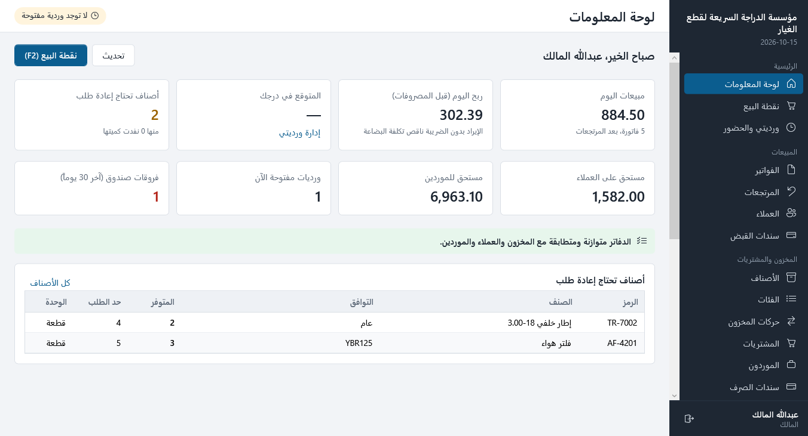
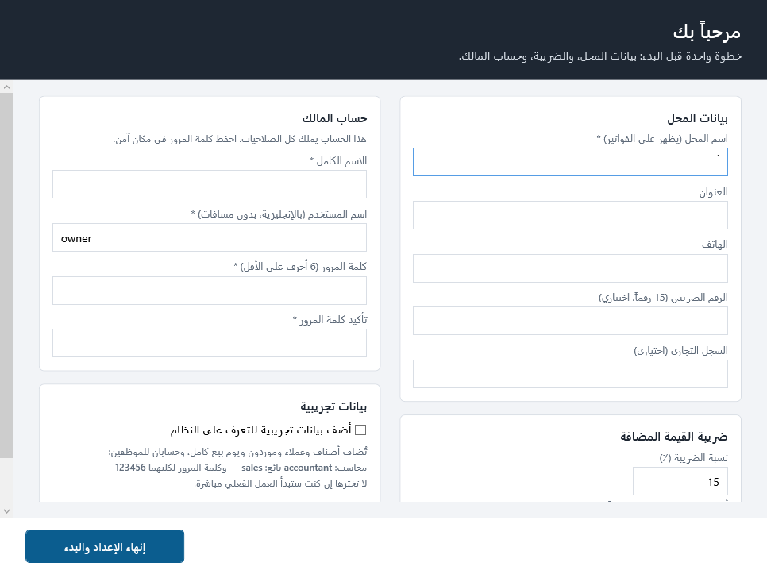
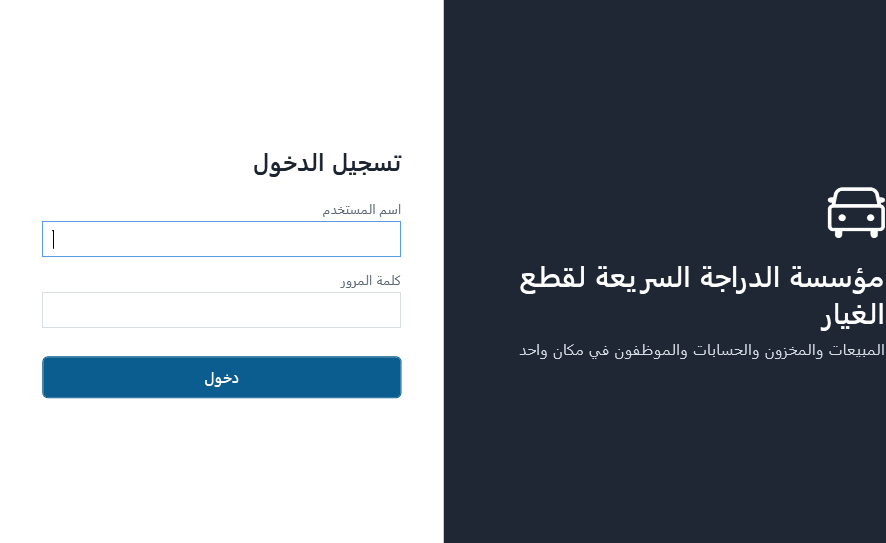
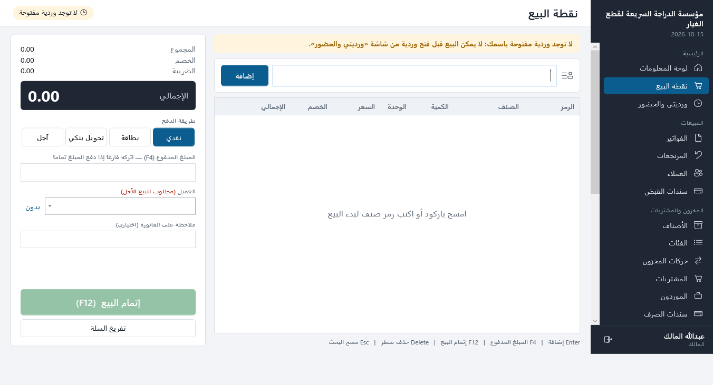
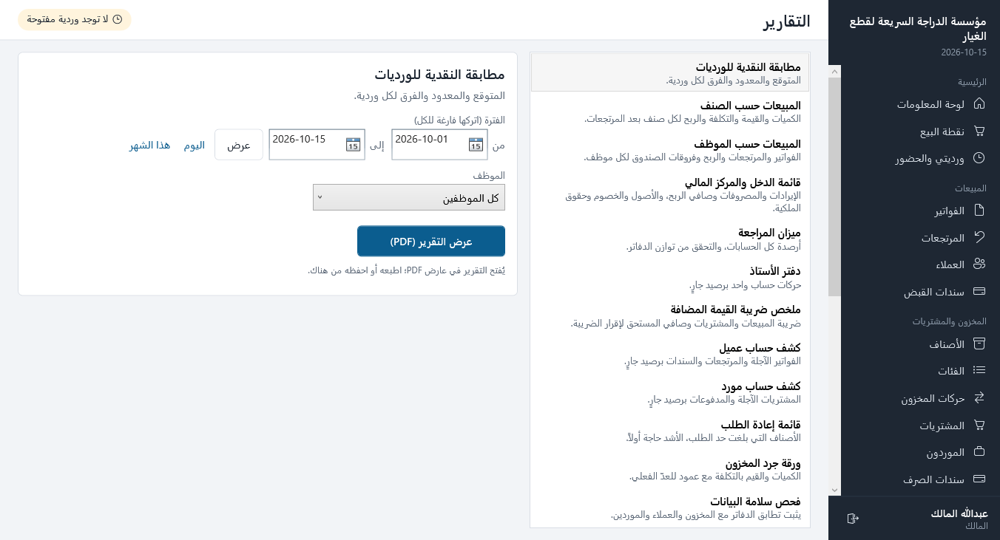
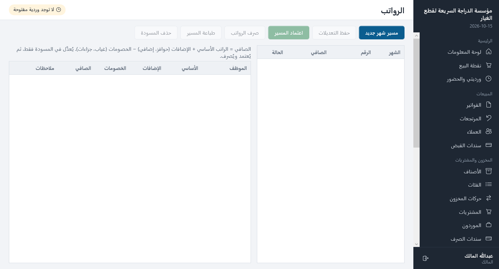
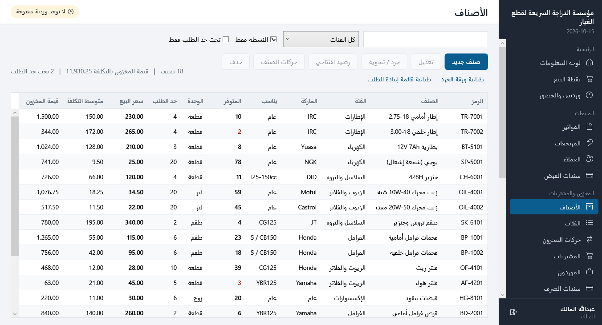
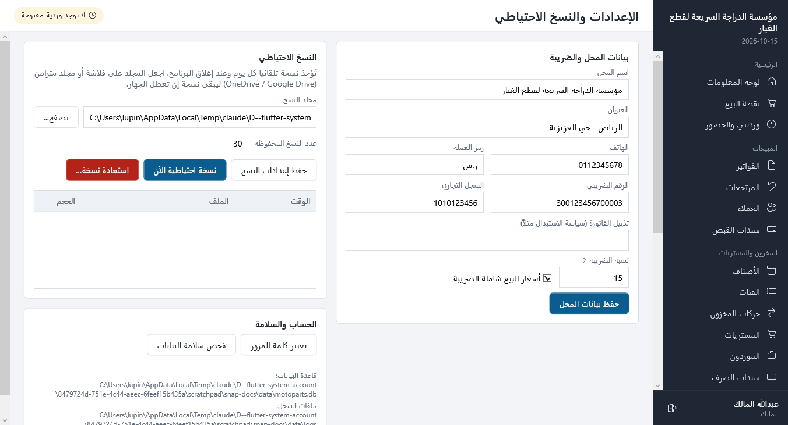

<div dir="rtl">

# نظام محل قطع غيار الدراجات النارية

برنامج سطح مكتب لنظام Windows يدير محل قطع الغيار بالكامل:
**نقطة البيع، المخزون، المشتريات، العملاء والموردين، المحاسبة بالقيد المزدوج، الورديات والحضور، والرواتب**.
البرنامج مكتوب بلغة C# (.NET 10 / WPF) وواجهته عربية بالكامل. يعمل على جهاز واحد دون إنترنت ودون خادم.



---

## المحتويات

1. [التشغيل لأول مرة](#التشغيل-لأول-مرة)
2. [الحسابات والصلاحيات](#الحسابات-والصلاحيات)
3. [العمل اليومي](#العمل-اليومي)
4. [الشاشات](#الشاشات)
5. [النسخ الاحتياطي والاستعادة](#النسخ-الاحتياطي-والاستعادة)
6. [أين تُحفظ البيانات](#أين-تحفظ-البيانات)
7. [ضمانات سلامة الحسابات](#ضمانات-سلامة-الحسابات)
8. [للمطوّرين](#للمطورين)

---

## التشغيل لأول مرة

**المتطلبات:** Windows 10 أو 11 بنظام 64 بت. لا يحتاج تثبيت .NET ولا أي برنامج آخر.

1. انسخ مجلد `MotoParts` كاملاً إلى الجهاز، مثلاً إلى `C:\MotoParts`. يحتوي المجلد على:
   - `MotoParts.exe` وهو البرنامج نفسه.
   - `appsettings.json` لإعدادات أماكن الحفظ (اختياري).
   - `QuestPDF.Fonts.Lato.br` وهو ملف خطوط يحتاجه محرك الطباعة. لا تحذفه.
2. انقر بزر الفأرة الأيمن على `MotoParts.exe` واختر **إرسال إلى ← سطح المكتب (إنشاء اختصار)**.
3. افتح البرنامج. في أول تشغيل تظهر **شاشة الإعداد**، وفيها:
   - بيانات المحل: الاسم والعنوان والهاتف والرقم الضريبي والسجل التجاري. تظهر هذه البيانات على الفواتير.
   - نسبة ضريبة القيمة المضافة (الافتراضي 15%)، واختيار هل أسعار البيع **شاملة** الضريبة أم لا.
   - حساب **المالك**: اسم الدخول وكلمة المرور. احفظهما جيداً.
   - خيار **إضافة بيانات تجريبية** (أصناف، موردون، عملاء، فواتير، وموظفان) للتعرّف على النظام قبل العمل الفعلي.



> **ملاحظة:** إن جرّبت النظام بالبيانات التجريبية وأردت البدء الفعلي بقاعدة نظيفة، أغلق البرنامج واحذف مجلد
> `%LOCALAPPDATA%\MotoParts\Data` (انسخه أولاً إن أردت الاحتفاظ به). عند الفتح التالي تظهر شاشة الإعداد من جديد.

---

## الحسابات والصلاحيات

| الدور | ما يستطيعه |
|---|---|
| **المالك** | كل شيء: المستخدمون، الإعدادات، النسخ الاحتياطي، إقفال الفترات المحاسبية، القيود اليدوية، الرواتب، الإغلاق الإجباري للورديات، كل التقارير. |
| **المحاسب** | البيع والاسترجاع، العملاء وسندات القبض، سندات الصرف للموردين، المصروفات، الاطلاع على الدفاتر والمخزون والمشتريات، تقاريره. |
| **البائع** | البيع من ورديته فقط، والاطلاع على الأصناف، وتسجيل حضوره. |

**الحسابات التجريبية**، عند اختيار البيانات التجريبية في الإعداد:

| الدور | اسم الدخول | كلمة المرور |
|---|---|---|
| المالك | ما اخترته في شاشة الإعداد | ما اخترته في شاشة الإعداد |
| المحاسب | `accountant` | `123456` |
| البائع | `sales` | `123456` |

- الموظف الذي يضيفه المالك يدخل بكلمة مرور مؤقتة، ويُطلب منه تغييرها عند أول دخول.
- لا تُحذف حسابات الموظفين؛ يُوقَف الحساب بدلاً من ذلك، فلا يستطيع صاحبه الدخول وتبقى سجلاته كما هي. ولا يُوقَف حساب موظف وورديته مفتوحة.
- يبقى في النظام دائماً مالك واحد نشط على الأقل.



---

## العمل اليومي

### 1. فتح الوردية
من **ورديتي والحضور** يسجّل الموظف حضوره ويفتح ورديته بمبلغ العهدة (النقد الموجود في الدرج).
لا يمكن البيع دون وردية مفتوحة، ولكل موظف وردية مفتوحة واحدة فقط.

### 2. البيع: نقطة البيع (F2)



| المفتاح | الوظيفة |
|---|---|
| **F2** | الانتقال إلى نقطة البيع من أي شاشة |
| **Enter** في خانة البحث | إضافة الصنف بالباركود أو الرمز (قارئ الباركود يعمل مباشرة) |
| **↓** | الانتقال إلى نتائج البحث بالاسم، ثم **Enter** للإضافة |
| **Esc** | مسح البحث |
| **F4** | الانتقال إلى خانة المبلغ المدفوع |
| **F12** أو **Ctrl+Enter** | إتمام البيع |
| **Ctrl+S** | الحفظ في نوافذ الإدخال |

- طرق الدفع: نقداً، شبكة، تحويل، أو **آجل** على حساب عميل. يُرفض البيع الآجل إن تجاوز حد ائتمان العميل، والعميل الذي حدّه صفر نقدي فقط.
- الخصم لكل سطر، ويُحسب الباقي للعميل تلقائياً.
- تُطبع الفاتورة بحجم A4 أو كإيصال حراري 80 مم، وفيها المبلغ كتابةً بالعربية.
- لا يُباع صنف بأكثر من الكمية المتوفرة.

### 3. الاسترجاع
من **الفواتير** اختر الفاتورة ثم **استرجاع**. يمكن استرجاع جزء من الكمية أو الفاتورة كاملة مع ذكر السبب.
تعود البضاعة إلى المخزون بتكلفتها الأصلية، ويُرد المبلغ نقداً من الوردية أو يُخصم من حساب العميل الآجل.

### 4. إغلاق الوردية
في نهاية الوردية يعدّ الموظف النقد ويدخله. يحسب البرنامج **المتوقع**:
العهدة + المبيعات النقدية + سندات القبض النقدية − المرتجعات النقدية − المصروفات النقدية.
يُسجّل **الفرق** (عجز أو زيادة) تلقائياً في حساب "عجز وزيادة الصندوق"، ويُطبع تقرير الوردية.
يستطيع المالك من **سجل الورديات** إغلاق وردية نسيها موظف (إغلاق إجباري)، أو تصحيح عدّ خاطئ، مع ذكر السبب في الحالتين.

---

## الشاشات

| القسم | الشاشات |
|---|---|
| **الرئيسية** | لوحة المعلومات (مبيعات اليوم والشهر، الأصناف الناقصة، الورديات المفتوحة، فروقات الصندوق)، نقطة البيع، ورديتي والحضور |
| **المبيعات** | الفواتير، المرتجعات، العملاء (كشف حساب ورصيد افتتاحي)، سندات القبض |
| **المخزون والمشتريات** | الأصناف (رصيد افتتاحي، جرد وتسوية، حركات الصنف)، الفئات، حركات المخزون، المشتريات (مسودة ثم استلام)، الموردون، سندات الصرف |
| **المالية** | المصروفات، التقارير، القيود اليومية (وقيد يدوي)، دليل الحسابات، الفترات المحاسبية (إقفال شهري) |
| **الموظفون** | سجل الورديات، سجل الحضور (مع التصحيح)، الرواتب |
| **الإدارة** | المستخدمون، سجل التدقيق، الإعدادات والنسخ الاحتياطي |

### التقارير
كل التقارير تُفتح ملفَّ PDF عربياً جاهزاً للطباعة أو الحفظ:

مطابقة النقدية للورديات · المبيعات حسب الصنف · المبيعات حسب الموظف · قائمة الدخل والمركز المالي ·
ميزان المراجعة · دفتر الأستاذ · ملخص ضريبة القيمة المضافة · كشف حساب عميل · كشف حساب مورد ·
قائمة إعادة الطلب · ورقة جرد المخزون · فحص سلامة البيانات.



### الرواتب
1. **مسير شهر جديد**: يُنشأ سطر لكل موظف نشط براتبه الأساسي.
2. أدخل **الإضافات** (حوافز، عمل إضافي) و**الخصومات** (غياب، جزاءات)، ثم **حفظ التعديلات**.
3. **اعتماد المسير**: يُسجَّل مصروف الرواتب في الحسابات، ولا يُعدَّل المسير بعده.
4. **صرف الرواتب**: نقداً أو تحويلاً بنكياً، فيُسدَّد التزام الرواتب المستحقة.



### الأصناف والمخزون



- التكلفة **متوسط مرجّح** يُحدَّث تلقائياً مع كل استلام بضاعة.
- الجرد: أدخل الكمية المعدودة فعلاً على الرف، فيسجّل البرنامج الفرق ويرحّل قيمته إلى حساب "تسويات المخزون".
- لا تُعدَّل الكمية يدوياً أبداً. كل تغيير في الكمية له مستند: بيع، أو شراء، أو مرتجع، أو جرد.

---

## النسخ الاحتياطي والاستعادة



- تُؤخذ **نسخة تلقائية** مرة كل يوم وعند إغلاق البرنامج، ويُحتفظ بآخر 30 نسخة (العدد قابل للتغيير).
- **نصيحة مهمة:** من **الإعدادات ← مجلد النسخ** اختر مجلداً على فلاشة أو مجلداً متزامناً مع OneDrive أو Google Drive،
  حتى تبقى نسخة من حساباتك إن تعطل الجهاز.
- **نسخة احتياطية الآن**: نسخة فورية، مثلاً قبل عملية كبيرة.
- **استعادة نسخة**: اختر النسخة من الجدول (أو من ملف)، فيتحقق البرنامج من صلاحيتها ويحفظ نسخة من البيانات الحالية أولاً، ثم يستبدلها ويعيد التشغيل.
- قبل أي تحديث لبنية قاعدة البيانات يأخذ البرنامج نسخة تلقائياً.

---

## أين تحفظ البيانات

| الملف | المكان الافتراضي |
|---|---|
| قاعدة البيانات | `%LOCALAPPDATA%\MotoParts\Data\motoparts.db` |
| النسخ الاحتياطية | `%LOCALAPPDATA%\MotoParts\Backups\` |
| سجلات الأخطاء | `%LOCALAPPDATA%\MotoParts\Logs\` |

يمكن تغيير هذه الأماكن من ملف `appsettings.json` بجانب البرنامج:

<div dir="ltr">

```json
{
  "DataDirectory": "D:\\MotoPartsData",
  "BackupDirectory": "E:\\Backups\\MotoParts",
  "LogDirectory": ""
}
```

</div>

يُفتح البرنامج مرة واحدة فقط على الجهاز، فلا يمكن تشغيل نسختين منه معاً على نفس البيانات.

---

## ضمانات سلامة الحسابات

صُمّم النظام بحيث لا يمكن أن تختل الدفاتر، حتى مع الأخطاء البشرية:

- **قيد مزدوج حقيقي**: كل عملية (بيع، استرجاع، شراء، سند، مصروف، جرد، رواتب، فرق صندوق) تُنشئ قيداً متوازناً تلقائياً، وقاعدة البيانات ترفض أي قيد غير متوازن.
- **لا تعديل ولا حذف للمستندات المرحّلة**: الخطأ يُصحَّح بمستند عكسي (استرجاع، إلغاء سند، قيد عكسي)، فيبقى الأثر كاملاً.
- **إقفال الفترات**: بعد إقفال الشهر لا يُقبل أي بيع أو شراء أو قيد بتاريخ داخله.
- **ترقيم متسلسل بلا فجوات** للفواتير والسندات والقيود: `INV-2026-000001` وهكذا.
- **سجل تدقيق** لكل عملية حساسة: من فعلها ومتى، والقيم قبل التعديل وبعده، والسبب.
- **فحص سلامة البيانات** (من الإعدادات أو التقارير) يثبت أن الدفاتر متوازنة، وأن رصيد المخزون في الحسابات يساوي قيمة الأصناف على الرفوف، وأن أرصدة العملاء والموردين والرواتب المستحقة مطابقة، وأن كميات الأصناف تطابق سجل الحركات.
- المبالغ تُحفظ أعداداً صحيحة بالهللة، فلا تحدث أخطاء تقريب عشرية.

---

## للمطورين

<div dir="ltr">

**Stack:** .NET 10 · WPF (MVVM, CommunityToolkit.Mvvm) · SQLite (Microsoft.Data.Sqlite + Dapper) · QuestPDF · BCrypt

```
src/
  MotoParts.Core/        domain, services, SQL migrations, seeding (no UI)
  MotoParts.Documents/   QuestPDF documents: invoices, receipts, reports (RTL Arabic)
  MotoParts.Desktop/     WPF application
tests/
  MotoParts.Tests/       xUnit tests against a real SQLite file per test
```

Build, test and run:

```bash
dotnet build
dotnet test
dotnet run --project src/MotoParts.Desktop
```

Publish a single self-contained `MotoParts.exe` (no .NET needed on the target PC) into `publish/MotoParts/`:

```bash
dotnet publish src/MotoParts.Desktop -p:PublishProfile=win-x64
```

Render every screen to PNG against a throwaway demo database (used for the screenshots above, and as a smoke test of a published build):

```bash
MotoParts.exe --snapshot C:\temp\shots
```

**Design notes**

- Business rules live in `MotoParts.Core` services. Invariants are also enforced in the database by triggers and constraints: balanced journals, immutable posted records, locked periods, and one open till per user.
- Money is stored as integer minor units (`Money`), quantities as thousandths (`Quantity`); stock value is tracked exactly per product.
- Schema changes are new numbered files in `src/MotoParts.Core/Data/Migrations`; the database is backed up before they are applied.

**Licences:** QuestPDF is used under its Community licence, which is free for businesses with annual gross revenue under USD 1M.
Above that, a commercial QuestPDF licence is required. All other dependencies are MIT/Apache-2.0.

</div>

</div>
